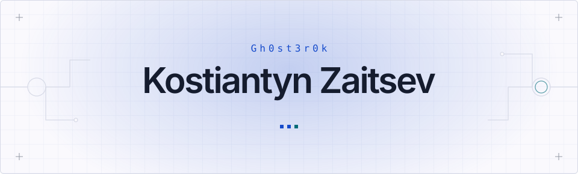
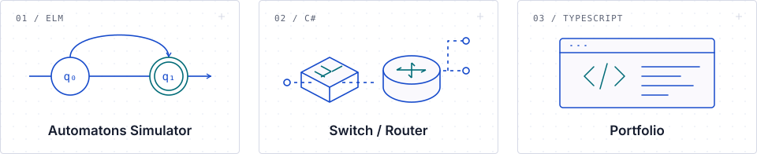

  <strong>English</strong> &nbsp; / &nbsp;
  <a href="./README.sk.md" lang="sk">Slovensky</a> &nbsp; / &nbsp;
  <a href="./README.uk.md" lang="uk">Українська</a>

<picture>
  <source media="(prefers-color-scheme: dark)" srcset="./assets/header-dark.svg">
  
</picture>

<h3>Software developer · Networking &amp; infrastructure</h3>

  I build software and explore how systems work, from application logic to network packets. 
  Master's student in Informatics at <strong>FIIT STU, Bratislava</strong>.

  <a href="https://gh0st3r0k.github.io/my-website/en/projects/">All projects</a> &nbsp; · &nbsp;
  <a href="https://gh0st3r0k.github.io/my-website/cv.pdf">CV</a>

 

<h2>01 / Professional focus</h2>

  Backend development, network applications and IT infrastructure. 
  I enjoy understanding architecture, tracing bugs and turning technical ideas into working implementations.

<h2>02 / Experience</h2>

  <strong>Ynet</strong> &nbsp; / &nbsp; IT Support &amp; Infrastructure Assistant 
  September 2025 — present 
  User support, hardware and software troubleshooting, network devices and cabling.

  <strong>PafuPlex</strong> &nbsp; / &nbsp; Backend Developer 
  January — May 2025 
  NestJS backend logic, data access and database communication. 
  Contributed to a recommendation system as part of the development team.

<h2>03 / Selected work</h2>

<a href="https://gh0st3r0k.github.io/my-website/en/projects/">
  <picture>
    <source media="(prefers-color-scheme: dark)" srcset="./assets/projects-dark.svg">
    
  </picture>
</a>

<h3>Automatons Simulator</h3>

  A browser-based formal automata editor and simulator, built in Elm. 
  My completed bachelor's thesis at FIIT STU: visual editing, step-by-step execution and model import/export.

<code>Elm</code> <code>SVG</code> <code>JavaScript</code>

  <a href="https://github.com/Gh0st3r0k/Simulator-FA">Source</a> &nbsp; / &nbsp;
  <a href="https://gh0st3r0k.github.io/Simulator-FA/#/">Try the simulator</a>

<h3>Switch / Router</h3>

  Educational networking applications with ASP.NET Core APIs and Electron clients. 
  From MAC learning and frame forwarding to IPv4 routing, ARP, RIPv2 and DHCP.

<code>C#</code> <code>ASP.NET Core</code> <code>Electron</code> <code>SharpPcap</code>

  <a href="https://github.com/Gh0st3r0k/Switch-SERVER">Switch source</a> &nbsp; / &nbsp;
  <a href="https://github.com/Gh0st3r0k/Router-Server">Router source</a>

<h3>Portfolio</h3>

  My multilingual portfolio with project case studies, experience and education. 
  Built with Next.js, React and TypeScript; statically exported to GitHub Pages.

<code>Next.js</code> <code>React</code> <code>TypeScript</code> <code>Playwright</code>

  <a href="https://github.com/Gh0st3r0k/my-website">Source</a> &nbsp; / &nbsp;
  <a href="https://gh0st3r0k.github.io/my-website/en/">Explore the website</a>

<h2>04 / Toolkit</h2>

  <strong>Languages</strong> 
  <code>C#</code> <code>Elm</code> <code>Rust</code> <code>JavaScript</code> <code>TypeScript</code>

  <strong>Applications</strong> 
  <code>ASP.NET Core</code> <code>NestJS</code> <code>Svelte</code> <code>Electron</code> <code>Next.js</code>

  <strong>Systems &amp; tools</strong> 
  <code>Linux</code> <code>Bash</code> <code>Git</code> <code>Networking</code> <code>Debugging</code>

 

<h3>Let's connect</h3>

Interested in opportunities in software development and IT.

  <a href="https://www.linkedin.com/in/kostiantyn-zaitsev-77779b311/"><strong>LinkedIn</strong></a> &nbsp; · &nbsp;
  <a href="mailto:zaitsev.kostiantyn2004@gmail.com"><strong>Email</strong></a>

